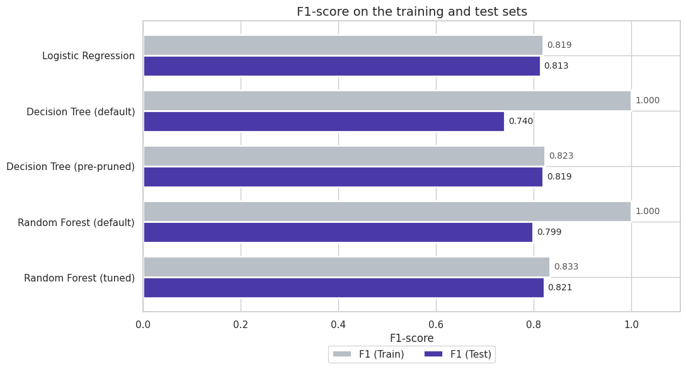
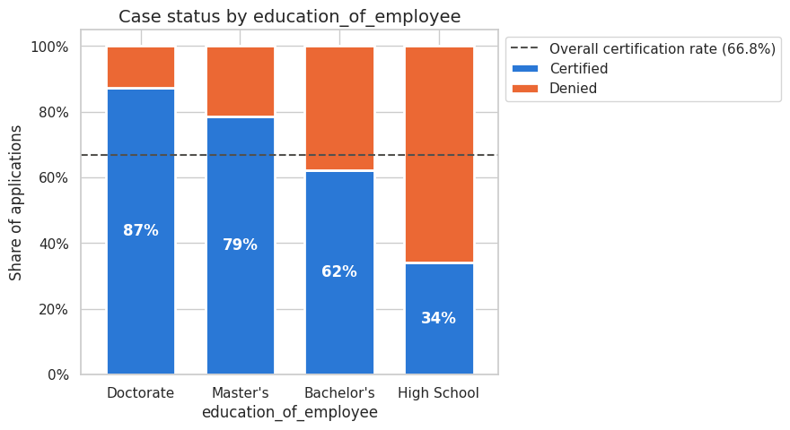
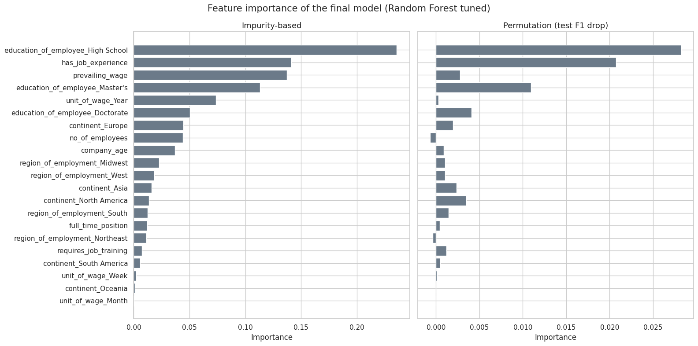

# EasyVisa: predicting US work-visa certification

Classification models that predict whether a US labor-certification application will be **Certified** or **Denied**, and the profile of applicants behind each outcome. The goal is to help the Office of Foreign Labor Certification (OFLC) **prioritize its review**, not to replace the officers' decision. Project for the MIT Professional Education *Applied AI & Data Science* program (Great Learning).

**Data:** 25,480 applications (FY 2016), 12 columns, no missing values. Test set: 7,644 applications (30%, stratified).

| Model | F1 (train) | F1 (test) | Recall (test) | Precision (test) |
|---|---|---|---|---|
| Logistic Regression | 0.819 | 0.813 | 0.875 | 0.759 |
| Decision Tree (default) | 1.000 | 0.740 | — | — |
| Decision Tree (pre-pruned) | 0.823 | 0.819 | 0.914 | 0.742 |
| Random Forest (default) | 1.000 | 0.799 | — | — |
| **Random Forest (tuned)** | **0.833** | **0.821** | **0.881** | **0.769** |

## What I did

- **Metric choice:** both errors are costly. A false positive approves an applicant who should be denied, and a false negative blocks a qualified one. So **F1** is the primary metric, with recall and precision reported alongside.
- **EDA:** univariate and bivariate analysis of every feature against the case status, plus multivariate profiles (education × experience × unit of wage × region).
- **Feature engineering:** `company_age = 2016 − yr_of_estab`; `case_id` dropped. `prevailing_wage` is **not** annualized, because weekly and monthly wages already sit on the yearly scale (median ~85,000), so multiplying them would create unrealistic values. `unit_of_wage` stays as its own feature.
- **Models:** Logistic Regression on scaled data, then Decision Tree and Random Forest on one-hot encoded data. The trees were tuned with `GridSearchCV` (stratified 5-fold CV, F1 scoring): best tree `max_depth=5, min_samples_leaf=50`, best forest `max_depth=10, min_samples_leaf=10`, 200 trees.
- **Interpretation:** impurity-based vs. **permutation importance** on the test set, and a check of how well the predicted probability matches reality.

## What the results show

- **Limiting tree complexity was the key step.** The default tree and forest scored a perfect 1.000 on training data and then dropped to 0.740 and 0.799 on test. Pre-pruning and tuning brought the train-test gap down to about one point.
- **Final model, tuned Random Forest:** F1 0.821, recall 0.881, precision 0.769 and accuracy 0.744 on unseen data. It produces the fewest false positives (1,349) and catches the most denied cases (46.9%).
- **The probability is usable for triage.** Among applications scored ≥ 0.8 (30% of the test set), 89.8% were certified. Below 0.5, only 33.9% were.
- **Drivers, in order:** education (34.0% certified for High School → 87.2% for Doctorate), job experience (74.5% vs. 56.1%), and **how** the job is paid (hourly 34.6% vs. yearly 69.9%). The wage **amount** has almost no effect once the unit is known.

## Recommendation

The notebook proposes a three-tier review: fast-track high-probability cases, standard review for medium ones, and a detailed review by senior officers for low-probability cases. That puts the officers' time where a wrong decision is most likely. The model's main limit is recognizing denials, so it should rank applications, not decide them.

## Run it

1. Put `EasyVisa.csv` in `data/`. The dataset was provided by the program and isn't redistributed here.
2. `pip install -r requirements.txt`
3. Open `easyvisa_approval_prediction.ipynb` and run all cells. In Colab, uncomment the Drive cell and adjust the path.

## Stack

Python · pandas · NumPy · scikit-learn · Matplotlib · Seaborn
